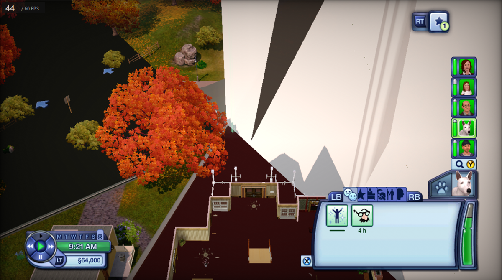
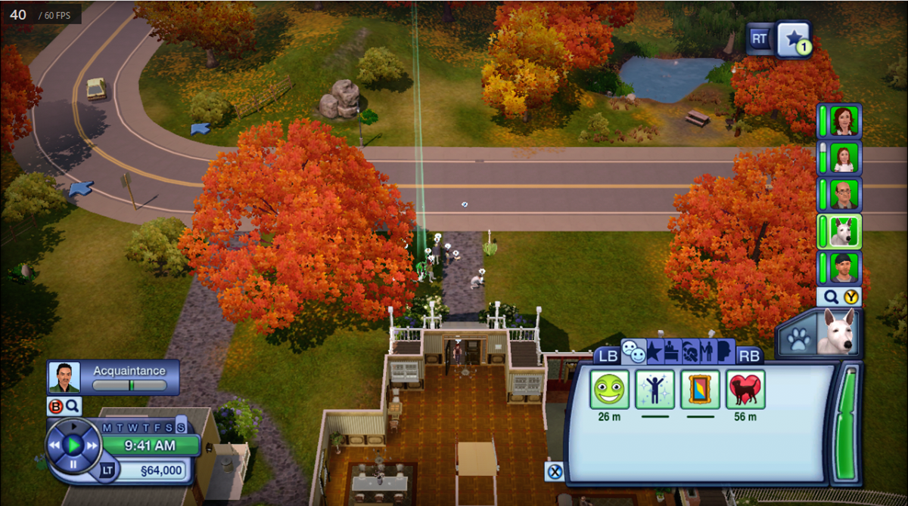

# The Sims 3 Pets (Xbox 360): Mod Menu and 60 FPS Patch

This project aims to be the definitive way to play **The Sims 3 Pets** for Xbox 360 today, in the [Xenia Canary](https://github.com/xenia-canary/xenia-canary) emulator. It fixes what goes wrong when the game runs in Xenia, makes it run at 60 frames per second instead of 30, and gives you the creative freedom of an in-game mod menu.

- **Bug fixes:** settings that stop the crashes, the garbled portraits and textures, the "Graphics device lost" error and the stray pet shadows.
- **60 FPS:** a patch that lifts the game's 30 FPS limit, and **Smart screen copies**, which let ordinary PCs actually reach 60 without breaking Sim portraits, outfits or pets. An optional on-screen FPS counter shows what you're getting.
- **Mod menu:** hold LT and press A on any Sim, pet, object or patch of ground. Edit or take over any Sim, play any household, warp the town around, make Sims and pets, unlock every karma power, and reach the game's hidden developer tools.

You need your own copy of the game. No game files are included here.

Suggestions and bug fixes are welcome: see [Suggestions and bug reports](#suggestions-and-bug-reports).

## Why this exists

The Sims 3 Pets on the Xbox 360 is one of my childhood games, and this project is a passion project. Coming back to it years later, I was saddened to find it was borderline unplayable in Xenia. Portraits turned into garbled squares. The game crashed, or lost the graphics device and closed. It crawled along at 12 to 15 frames per second on a modern PC. Pets fell apart into spikes and stretched meshes, and Sims came out of Create a Sim with patches of other textures in their clothes.

So I set out to fix it, for myself and for anyone else who grew up with it. Each fix here was traced to its cause and tested on copies of real saves before it went in, and the reasons are written down below. The mod menu adds the freedom to play any household, edit any Sim and shape the town however you like.

— Atronode

## Quick start

1. Apply the [Xenia fixes](#fix-the-crashes-garbled-textures-and-stray-shadows).
2. Download this repository and put the `mod-menu` folder next to your `xenia` folder and your game's `.iso` ([details](#set-it-up)).
3. Double-click **Sims 3 Pets FPS Patch.bat** in `mod-menu`. Press **1** for 60 FPS, then **4** for Smart screen copies, then **7** to close.
4. Double-click **Play Sims 3 Pets (Mod Menu).bat** to play. Hold **LT** and press **A** to open the mod menu.

## This build

| | |
|---|---|
| Created | 10 November 2026, 02:35 UTC |
| Updated | 13 November 2026: switched the renderer to Vulkan, which fixes the "Graphics device lost" crash and the stray pet shadows; the launcher now survives quitting to the main menu |
| Updated | 16 November 2026: 60 FPS patch, Smart screen copies and the FPS counter |
| Updated | 17 November 2026: Pets look right, a fix in the game's own code that keeps dogs and cats in shape at full speed, even in a crowd; Pet safe mode in the `.bat` as a fallback |
| Updated | 21 November 2026: Smart screen copies works around a Xenia bug that left patches of other textures in Sims' outfits after Create a Sim; it also waits longer for its helper, and the launcher keeps it up to date |
| Xenia Canary branch | [`canary_experimental`](https://github.com/xenia-canary/xenia-canary/tree/canary_experimental) |
| Xenia Canary commit | [`cf206a3bd`](https://github.com/xenia-canary/xenia-canary/releases/tag/cf206a3) |
| Build date in Xenia's log | Nov 8 2026 |
| `xenia_canary.exe` SHA-256 | `1A2C17275A7BEC1939BEC523FC512CE244E27213D2E0CC680E03A231A5DDB3FF` |
| Renderer | Vulkan, FBO render target path |
| Xenia settings | [config/xenia-canary.config.toml](config/xenia-canary.config.toml), every setting, with the profile ID removed |
| Game | The Sims 3 Pets, title ID `45410962`, version `0.0.0.3` |

## Fix the crashes, garbled textures and stray shadows

1. Back up your Xenia folder.
2. Download `xenia_canary_windows.7z` from the [cf206a3 release](https://github.com/xenia-canary/xenia-canary/releases/tag/cf206a3) and replace your `xenia_canary.exe` with the new one.
3. Open `xenia-canary.config.toml`, next to the exe, and set these under `[GPU]`:

   ```toml
   gpu = "vulkan"
   render_target_path_vulkan = "fbo"
   async_shader_compilation = false
   readback_resolve = "full"
   readback_memexport = true
   ```

4. Start the game. The window title should end in "Vulkan - FBO". Brief stutters are normal the first time new things appear, and they fade as shaders are cached.

Portraits saved while they were corrupted stay corrupted, so start from a save made after these changes. Keep the `fbo` render target path. The more accurate `fsi` path ran at about 10 frames per second, caused a GPU timeout and didn't bring the shadows back. Direct3D 12's ROV path made shadows worse.

### Why these work

- **Crashes:** [BorealisEcho's report](https://github.com/xenia-canary/game-compatibility/issues/135#issuecomment-6019598941) showed the two readback settings fix Sim pictures, corrupted textures and vertex explosions, but the game still crashed. Older builds could overwrite game memory with `readback_memexport` on, which [PR #1325](https://github.com/xenia-canary/xenia-canary/pull/1325) fixed. The updated build didn't crash in testing. The old build wasn't re-run for comparison, so this is the likely cause rather than a proven one.
- **"Graphics device lost":** This message means the graphics driver stopped responding for more than two seconds and Windows reset it. Xenia can't recover from a reset, so it closes. On Direct3D 12 the game hung the graphics card just as something new was drawn: looking into a house, a household arriving indoors, a new pet appearing. On Vulkan the same steps caused no driver resets.
- **Stray pet shadows:** On Direct3D 12, a pet's shadow indoors is drawn as a hard dark blob in front of its head instead of under its body, and the blob jumps around as the pet moves. Vulkan doesn't draw the blob. It doesn't draw the proper shadow either; see [Known issues](#known-issues).
- **Garbled portraits:** The game appears to draw each portrait once and keep it. With `async_shader_compilation` on, Xenia [skips draws whose shaders aren't ready](https://github.com/xenia-canary/xenia-canary/blob/cf206a3/src/xenia/gpu/d3d12/pipeline_cache.cc#L570), so Sims lost their hair or turned into green squares and grey bars. With it off, the same test stayed clean, even with an empty shader cache.

### Testing

Build `cf206a3` ran one 43-minute scripted session with no crash or freeze. That covered 34 Sim-switch attempts, 28 rounds of zooming, Town Map scrolling, the Build/Buy catalog, save-and-quit, Create-a-Sim and moving in a pre-made family. Atronode then played it on an Xbox 360 controller and reported it working.

On 13 November 2026, after testers hit "Graphics device lost", both renderers were compared on an RTX 5060 (driver 617.14) using copies of the saves. Direct3D 12 lost the graphics device in both indoor sessions, each time with a Windows driver reset. Vulkan ran about 2½ hours on the `fbo` path without a single GPU timeout or driver reset. That covered looking into the house, warping the household in, new pets from Make Pet, saving and carrying on, Build/Buy, 27 minutes indoors with autonomy on, and quitting to the main menu and loading again. Portraits stayed clean on Vulkan, even with an empty shader cache. Other PCs weren't tested, and longer sessions could still crash.

### If it still crashes

1. Check that the window title ends in "Vulkan - FBO".
2. In Windows, open Start, type "reliability" and open **View reliability history**. A "LiveKernelEvent" or hardware error at the time of the crash means the graphics driver was reset.
3. If those resets also happen when Xenia isn't running, the cause is the PC rather than the game. Update the graphics driver, turn off any overclocking, and make sure the graphics card is pushed firmly into its slot.

### Known issues

- **The game's own bugs.** The Sims 3 Pets was buggy even on a real Xbox 360, and those bugs are still there. Some problems may remain that neither Xenia nor this project causes. If you find one, please [report it](#suggestions-and-bug-reports).
- **TVs sometimes freeze.** Sometimes a TV plays no sound, and its picture can freeze. This happens on a real Xbox 360 too, so it's a bug in the game itself, not in Xenia or this project.
- **Broken household pictures.** The family picture on the save menu and in household creation can come out broken: instead of the Sims, it shows speckled green outlines of them with black patches. It may have started with the recent fixes, possibly linked to the outfit damage, but the cause hasn't been found yet and it isn't fixed.
- **No shadows under Sims and pets indoors.** On the real console, Sims and pets have a soft shadow under them. Xenia's Vulkan renderer doesn't draw it, and Direct3D 12 draws a misplaced blob for pets instead. The `fsi` render path and the `depth_float24_convert_in_pixel_shader` and `depth_float24_round` settings were tried and none brought it back. This is the next bug I aim to fix; see [What's next](#whats-next).

### Related reports

- [Canary compatibility report #135](https://github.com/xenia-canary/game-compatibility/issues/135)
- [Original Xenia report #1587](https://github.com/xenia-project/game-compatibility/issues/1587)
- [PR #1325: memexport readback](https://github.com/xenia-canary/xenia-canary/pull/1325)
- [Commit 5845f3437: async shader compilation](https://github.com/xenia-canary/xenia-canary/commit/5845f3437b8c22f95d4b9daee008c7b6e58c1fd8)

## Frame rate: 60 FPS

The game is built to run at 30 frames per second. Two parts take it to 60:

- **The 60 FPS patch** removes the game's own 30 FPS limit.
- **Smart screen copies** remove the copying that holds the game far below 60 in Xenia, and keep Sim portraits and pets correct.

### Turn it on

1. Close Xenia.
2. Double-click **Sims 3 Pets FPS Patch.bat** in the `mod-menu` folder.
3. Press **1** for 60 FPS (recommended) or **2** for unlocked, then **4** to turn Smart screen copies on, then **7** to close.
4. Start the game with **Play Sims 3 Pets (Mod Menu).bat**.

The menu shows what's on now. Press **3** to go back to 30 FPS, **4** again to turn Smart screen copies off, **5** to turn the FPS counter on or off, and **6** for [Pet safe mode](#pet-safe-mode), which you shouldn't need.

### The 60 FPS patch

The game asks the Xbox 360's graphics system to wait for two screen refreshes per frame, which caps it at 30 frames per second. The patch changes one byte so it waits for one refresh (60 FPS) or none (unlocked).

The same file also carries **Late frames don't wait**. When a frame isn't ready in time for a refresh, the game normally waits for the next one, so a frame that takes just over 1/60 s drops the game straight to 30 FPS. The patch sets the Xbox 360's "present immediately if late" threshold to 100%, so a late frame is shown as soon as it's ready instead. Frames on time still wait for the refresh, so the game never goes above 60.

This is what fixed the camera spinning at a flat 30 when zoomed out: it went to about 52 with everything else equal. Xenia shows whole frames, so it doesn't tear.

The `.bat` copies a patch file into `xenia\patches`. Xenia's title bar then shows "[Patches Applied]". To do it by hand, copy [`mod-menu/fps-patch/60 FPS.toml`](mod-menu/fps-patch) into `xenia\patches` and rename it `45410962 - The Sims 3 Pets.patch.toml`. It needs `apply_patches = true`, which is Xenia's default.

### Smart screen copies

Sim portraits only come out right with Xenia's two readback settings on (`readback_resolve` and `readback_memexport`, set in the fixes above). They make Xenia copy every picture the game draws back from the graphics card, dozens of times a frame. On the test PC that was about 130 MB per frame, which held the game at 12 to 15 FPS with or without the 60 FPS patch.

The game only ever reads a few of those pictures back: Sim portraits and other thumbnails, the pictures Create a Sim builds outfits from, the pictures stored with each save, and in-game screenshots. With Smart screen copies, the game asks before it draws one of those. The launcher then turns readback on, lets the game carry on, and turns it off again a moment after the last one. Everything else is drawn without copying.

| Test PC (Ryzen 5 8400F, RTX 5060), with a dog in view | Frames per second |
|---|---|
| Readback on, as the fixes above set it | 12 to 15 |
| Readback on, with the 60 FPS patch | 12 to 15 |
| 60 FPS patch and Smart screen copies, close up | 60 |
| The same, zoomed all the way out | 60 |
| The same, spinning the camera zoomed out | about 52 |
| The same, zoomed out over the whole town gathered with Summon The Town Here | 40 to 45 |

Checked on copies of the saves, where every portrait and picture came out right:

- a household arriving, with five portraits drawn;
- live mode outdoors and indoors;
- zooming out for the first time in a session, with portraits drawn for the Sims coming into view, and the relationships panel afterwards;
- Create a Sim, with a new hairstyle and the portrait redrawn afterwards;
- editing a Sim in Create a Sim straight after loading, the hardest case for [outfits](#sims-outfits);
- the Town Map, Build & Buy and the Buy catalog;
- saving, including the household and house pictures stored with the save;
- Take Screenshot from the pause menu;
- quitting to the main menu and loading again;
- picking Sims with the mod menu.

When new Sims come into view, for example the first time you zoom out somewhere, the game draws their portraits. That costs a short hitch of about half a second per Sim. Thumbnails, save pictures and screenshots need only a few hundredths of a second.

Good to know:

- It only works when you start the game with **Play Sims 3 Pets (Mod Menu).bat**. Started any other way, the game keeps Xenia's own settings and runs as before.
- It never edits Xenia's settings file. It changes the two readback settings in the running Xenia only, and leaves them alone if your settings file already has them off.
- It was built for Xenia Canary `cf206a3bd`. On other builds, the launcher looks for the two settings by name. If it can't find them, it changes nothing.
- The fix for [Sims' outfits](#sims-outfits) is part of Smart screen copies, so it only applies while Smart screen copies is on.
- The launcher keeps the installed copy of Smart screen copies the same as the one in the `mod-menu` folder, so a newer version takes effect the next time you start the game.
- If a portrait or picture ever comes out wrong, press **4** in the `.bat` to turn Smart screen copies off, and please report what you were doing.

#### How it works

Every screen copy in the game goes through the Direct3D function `D3DDevice_Resolve`. Counting calls at each copy call site showed which ones run every frame for the normal scene and which only run for portraits, thumbnails, save pictures and screenshots. One of them belongs to the game's `ThumbnailRenderer`.

The patch ([`Smart screen copies.toml`](mod-menu/fps-patch)) sends the 13 rare call sites through a short stub. The stub writes a request into spare memory at the end of the game's data section. It then waits until the launcher's helper ([`SmartReadback.ps1`](mod-menu/SmartReadback.ps1)) has switched Xenia's readback on, which normally takes a millisecond or two. The helper runs at high priority and asks Windows not to slow it down in the background. If the helper has stopped, the game gives up after about 1.3 seconds, once, and stops asking until the helper is back. An earlier version gave up after about 60 ms, which was too short whenever Windows held the helper back for a moment: the copy was then made with readback off, and garbage could end up in a portrait, a save picture or an outfit.

The stub then makes the copy twice; [Sims' outfits](#sims-outfits) explains why.

Xenia reads both settings again on every copy and draw, so the switch takes effect straight away. The helper switches readback off again as soon as the game's own frame counters show that the graphics card has finished the frame holding the copy, plus one more frame.

Two passes were left out after checking that they look identical with readback off:

- an indoor pass that runs every frame;
- the redraw of water and mirror reflections while the camera moves. This one used to hold the frame rate at 4–16 for about two seconds on a first zoom out.

If the helper isn't running, the stub doesn't wait, and the game keeps Xenia's own settings. The copies are still made twice.

### Sims' outfits

Before this fix, a Sim's outfit could come out of Create a Sim with patches of other textures in it: blocks of skin or shirt in the hair or a hat, dashes across the face, a broken necklace. Create a Sim saves the outfits it builds with the household, so the patches stayed in the save.

| Test PC, `fbo` render path: edit a Sim in Create a Sim straight after loading, then save | Outfits damaged |
|---|---|
| Before the fix | 2 of 3 (17 of 22 over every test run before the fix) |
| With the fix | 0 of 8, each identical to a clean outfit, block for block |

**Why it happened.** Create a Sim builds each outfit from several pictures drawn on the graphics card. It copies each one back to the game's memory and packs them into the outfit's texture on the processor. Xenia's Vulkan renderer starts that copy before the graphics card has finished writing the picture. In [`VulkanCommandProcessor::IssueCopy`](https://github.com/xenia-canary/xenia-canary/blob/cf206a3/src/xenia/gpu/vulkan/vulkan_command_processor.cc#L3607-L3614), the barrier that should make the copy wait is queued, but it isn't recorded before the copy. Xenia's pet-fur readback in the same file [records it first](https://github.com/xenia-canary/xenia-canary/blob/cf206a3/src/xenia/gpu/vulkan/vulkan_command_processor.cc#L3133-L3134). So the copy can pick up pieces of the previous picture. Pausing the game after each copy and reading its memory showed exactly that: every wrong block held the previous picture's data, in whole 32-byte pieces, mostly at the start of the copy. It showed up mainly on the `fbo` render path. The `fsi` path has the same flaw but never showed it in testing, and it's much slower anyway.

**The fix.** Smart screen copies now makes each of its rare copies twice. The second copy reads memory that the first one has finished writing, so it always comes out whole. Both copies make the same picture, because the game's copy function never clears anything. Ordinary frames don't change, so the frame rate is the same.

Patchy clothes after a pregnancy are probably the same bug, since the game builds new outfits then, but that case wasn't tested on its own.

**If a save already has damaged outfits.** The damage stays in that save until the outfit is built again. Pick **Edit in CAS** on the Sim in the mod menu, choose Done, then save. The game builds that Sim's outfits and portrait again.

### Pets look right

The Smart screen copies file also carries a second patch, **Pets look right**. Without it, dogs and cats break while readback is off: a hole at the neck, white spikes and slabs, twitchy idle animations and, in a crowd, meshes and textures stretched across the map.

| Without Pets look right | With Pets look right |
|---|---|
|  |  |

Both pictures show the same test: the whole town gathered on one lot with Summon The Town Here, a few minutes in, with the camera zoomed out. Without the patch, the white and dark wedges are pet meshes stretched across the map.

The game draws pets differently from Sims. Each frame the graphics card poses every pet's body and fur and writes the result into a buffer in memory (the game's `simpetfur_memexport_xenon` shader), and the pet is then drawn from that buffer. Xenia also keeps a processor-side copy of that memory, and with memexport readback off, nothing ever updates that copy. That's harmless as long as Xenia never reloads the buffer from it. Three quirks in the game made Xenia reload it:

1. **Shared memory pages.** The game placed each pet's buffer right next to other data, so the buffer's first and last 4 KB memory pages were shared with things the game writes all the time. Each of those writes made Xenia reload the whole page, pet included, from the stale copy.
2. **The memory tidier.** Every frame the game moves some graphics buffers to lower addresses to keep memory tidy. In a crowd that soon put pet buffers back on shared pages.
3. **A size mistake.** The game tells the graphics card the buffer is 16 times bigger than it is, so Xenia treated far more memory as written by the graphics card than really was.

The patch gives every pet buffer whole memory pages of its own, keeps it that way when the tidier moves it, and passes the true size. It costs no speed.

| Test PC, 60 FPS patch, Smart screen copies and Pets look right | Frames per second | Pets |
|---|---|---|
| A dog close up | 60 | correct |
| A dog chasing its tail | 60 | correct |
| The whole town gathered with Summon The Town Here, zoomed out, for about 12 minutes | 40 to 45 | correct |
| The same crowd up close | 60 | correct |

In the 12-minute run, 24 different pet buffers came and went, the game's memory tidier moved four of them, and every one stayed on pages of its own. The [stress test](#stress-test) repeated this in three places, by day and at night, with the camera spinning. Keeping Xenia's memexport readback on also fixes pets, but makes Xenia wait for the graphics card once per frame for each pet on screen, which costs a lot of speed (see Pet safe mode below).

#### Pet safe mode

If pets ever still look wrong on your PC, press **6** in **Sims 3 Pets FPS Patch.bat**. Pet safe mode keeps memexport readback on, so Xenia copies pet fur back from the graphics card every frame and pets are always right. The frame rate drops while pets are on screen. On the test PC it was 60 for a dog close up, about 56 spinning zoomed in, 36 to 40 zoomed out, and 24 to 38 with the whole town gathered. It works when you start the game with **Play Sims 3 Pets (Mod Menu).bat**, and it's off by default. Press **6** again to turn it off.

#### How the pet patch works

Memory pages matter because Xenia watches the game's writes 4 KB page by 4 KB page. When the processor writes anywhere in a page, Xenia marks the whole page as changed and uploads it to the graphics card again before the next draw that uses it, overwriting whatever the graphics card wrote there.

- **Pages of its own:** the game creates each pet buffer through its usual vertex buffer function. The patch sends that one call to a copy of the function that asks the allocator for 4096-byte alignment and a size rounded up to whole pages.
- **Staying put:** the memory tidier asks for a new block with 4-byte alignment whenever it moves a buffer. The patch gives pet buffers their own copy of the buffer's resource method table, with the same methods; only the buffer's own constructor and destructor refer to the original. The tidier's allocation then goes through a short wrapper. Buffers with that copy get page alignment and a page-rounded size, and every other buffer is moved exactly as before.
- **True size:** the setup for the pet fur export puts the buffer's size in bytes where the graphics card expects a count of 16-byte items. The patch divides it by 16.

Each change is checked against the bytes it replaces before the patch file is written ([`tools/make_pets_look_right.js`](tools/make_pets_look_right.js)).

### FPS counter

Press **5** in **Sims 3 Pets FPS Patch.bat** to turn the counter on or off. When it's on, starting the game with **Play Sims 3 Pets (Mod Menu).bat** shows a small box in the top-left corner of the picture, for example **15 / 60 FPS**. The first number is frames shown in the last second. The second is the most the game allows: 60 with the patch, 30 without it, or "no limit" with the unlocked patch. Both are read from the running game, so the second number also confirms the patch is active. The counter stays visible in full screen (F11), hides while another window is in front, and closes with the game. It only reads the game's memory and changes nothing.

If the first number stays well below the second, turn Smart screen copies on first. If it's still low, your PC is the limit, not the patch. On an NVIDIA card, `nvidia-smi --query-gpu=pcie.link.width.current,pcie.link.width.max --format=csv` shows whether the card is using all of its PCIe lanes.

### Measured limits

With readback off, so that nothing but the game itself held it back, the test PC reached:

| Setting | Frames per second |
|---|---|
| No patch | 30 (the game's own limit) |
| 60 FPS patch | 59 |
| Unlocked patch | about 80, limited by the processor |

The in-game clock ran at the same speed in all three (24–25 game minutes per real minute), so the game doesn't speed up at 60. The test PC's graphics card was connected on one PCIe lane instead of eight, which is why readback cost so much there (it filled that lane at about 2 GB/s). Readback should cost less on a card that uses all its lanes, but that wasn't measured.

### Stress test

On 17 November 2026 everything above was tested together at full intensity, on copies of the saves. That covered the 60 FPS patch, Smart screen copies and Pets look right, in three places, with the whole town gathered by Summon The Town Here. In each place the camera spun for 12 seconds fully zoomed in, then 12 seconds fully zoomed out.

| Place (average frames per second while spinning) | No crowd, zoomed in | No crowd, zoomed out | Crowd, zoomed in | Crowd, zoomed out |
|---|---|---|---|---|
| The Gilman house, morning | 59 | 52 | 45 | 41 |
| Kids Kastle & Playground, afternoon | | | 46 | 34 |
| The Kingsley house on Sugar Maple Coast, at night | | | 48 | 31 |

Every pet stayed in shape, and no textures broke. Up to 24 pet buffers were drawn at once, all on pages of their own. A new dog and a new kitten made with the mod menu got the fix too, and so did every pet after quitting to the main menu and loading again. There were no crashes. Once, at the Gilman house, the game paused for about 1.75 seconds while the crowd was arriving.

On the test PC, busy scenes like these are held back by the graphics card's connection, not by the patches. The card runs on one PCIe lane instead of eight, which carries about 1.1 to 1.3 GB/s. Even with readback off, the game sends the graphics card about 14 MB of data per frame close up, and 20 to 43 MB per frame over a crowd. In every test the frame rate came out at the link's speed divided by the data per frame: about 60 standing still close up, and 31 to 48 while spinning over the crowds. A card using all of its lanes has at least eight times that bandwidth, so these scenes should run much closer to 60 there. That wasn't measured.

## Mod menu

### Screenshots

Taken in Xenia on a copy of the saves, with the mod menu installed.

#### The Sim menu


Hold **LT** and press **A** on a Sim, here the Grim Reaper. The menu lists Warp To Me, Warp Me To Them, Play As This Sim, Add To My Household, Edit in CAS, Set Relationship, Add or Increment Skill, Set Motive and Needs. The round orange icon marks an option added by this mod. Plain pills such as Set Relationship are the game's own hidden debug options, which the mod now brings up in the normal menu. This means any Sim, even one you can't normally control, can be edited, moved or taken over from here. The funds in the corner show §20,000 after using the Money options.

#### The ground menu


The same gesture on empty ground gives world options: Warp Me Here, Warp My Household Here and Summon The Town Here (every Sim in town walks up to that spot), plus Make Sim, Make Death, Make Pet, Make Breed, Build Or Buy On This Lot and Move Household Out. This is how you move around the world, create Sims and pets, or change a lot without leaving the game.

#### Karma powers, all unlocked


The Karma Powers panel with the meter at 183 of 250 and Meteor Strike selected (cost 67). Normally these powers have to be bought with challenge points first. The launcher unlocks them every time a game loads, including the red "bad" powers such as sickness, ghosts, fire and meteors, so the Build mode challenge step is no longer needed.

#### Households the game doesn't let you play


On the Town Map, the Xu household at 313 Harvest Nook is selected with the View and Interact options. The portraits on the right are that household's members. Households like this normally can't be played. With the mod, Play This Household and Play As This Sim take you into them.


The result: the player is now controlling a Sim from the Xu household, shown in the portrait list and the Sim panel at the bottom right. Funds are §13,300, that household's own money.


Build mode on a large, dark house with a pond, showing its Lot Value (§161,549 furnished). This is a lot the game normally keeps closed to players. With the mod you can enter its lot and use Build Or Buy On This Lot to look around or change it.

### Set it up

1. Apply the fixes above.
2. Download this repository (**Code**, then **Download ZIP**) and unzip it.
3. Put the `mod-menu` folder next to your `xenia` folder and your game's `.iso` file. The file's name must include Sims, 3 and Pets.
4. For 60 FPS, run **Sims 3 Pets FPS Patch.bat** once, as described in [Frame rate](#frame-rate-60-fps).

```text
Any folder
├── xenia                 (holds xenia_canary.exe)
├── The Sims 3 Pets.iso
└── mod-menu
```

### Play with it

1. Close Xenia if it's open.
2. Double-click **Play Sims 3 Pets (Mod Menu).bat** in the `mod-menu` folder.
3. The game opens along with a small black window. Leave that window open while you play. It closes when the game does.
4. Load your save. All challenge rewards, including the karma powers, unlock each time a game loads.

Always start the game this way. If you open the game straight from Xenia, there's no menu. Quitting to the main menu and loading another game is fine: the launcher puts the menu back by itself.

### Open the menu

Hold **LT** and press **A** while pointing at a Sim, a pet, the ground or an object. Press **B** to go back, and push the stick up or down to scroll.

| Pointing at | Options |
|---|---|
| A Sim | Warp To Me, Warp Me To Them, Play As This Sim, Add To My Household, Edit in CAS, Set Relationship, Add or Increment Skill, Set Motive, Needs, Age, Traits & Wishes, Career, Family, Die By, Force Reset, Money, Time |
| Age | Age Up, Age Down (one life stage younger, as far as toddler; pets go elder, adult, then young), Age Up Tomorrow |
| Traits & Wishes | Change Traits (the game's own trait picker), Add Random Trait, Complete Lifetime Wish |
| The ground | Warp Me Here, Warp My Household Here, Summon The Town Here, Make Sim, Make Pet, Make Breed, Add Fire, Add Puddle, Add Trash Pile, Build Or Buy On This Lot, Move Household Out, Bulldoze This Lot, Spawn Rocks And Gems, Money, Time |
| An object | Clone, Delete It, Add To Family Inventory |
| A house on the map | Play This Household, Repair All Objects, Move Household In or Out, Add To Household |
| A mailbox | AutoPay Bills, Make Everything Unbreakable, Unlock All Lots, Relics, Mystery Rewards and Challenges |
| Anything | Developer Tools, which holds all the game's leftover test options |

Some options change your save for good once you save, such as Die By, Bulldoze, Move Household Out and Delete It. Back up your saves first. Developer Tools are the game's unfinished test options, so a few may do nothing or misbehave.

### What has been tested

All testing used copies of the saves.

| Tested and working | Not tested yet |
|---|---|
| Menus on a Sim, a pet and the ground | Play As on a Sim from a different family |
| Developer Tools folder | Age Down at stages other than adult to young adult |
| Warp Me Here, Warp My Household Here, Summon The Town Here | Add Random Trait, Complete Lifetime Wish |
| Money, Time | Career and Family options |
| Play As on a Sim in the same household | Add To My Household |
| Karma powers unlocking | House and mailbox menus |
| Age Up, Age Down from adult to young adult | Clone and Delete It |
| Change Traits opening and selecting a trait | Going below young adult with Age Down, which leaves adult jobs and partners in place |
| Make Pet (cats and dogs) | |
| Menu and karma unlock after quitting to the main menu and loading again | |
| All of the above on the Vulkan renderer | |

### How it works

The launcher starts Xenia, waits for the game to load its script code, then writes small changes into the game's memory. It also starts the FPS counter and the Smart screen copies helper when they're switched on; both run hidden and close with the game. Before changing anything, it checks each location against a SHA-256 hash, and if your copy doesn't match, it leaves the game alone. The game reloads its script code when you go back to the main menu, so the launcher keeps checking while you play and writes the changes again whenever they disappear. Nothing on disk changes: your game file, Xenia and your saves stay as they are.

## What's next

The next bug I aim to fix is the missing shadows under Sims and pets indoors. On a real Xbox 360, Sims and pets indoors have a soft shadow under them. Xenia's Vulkan renderer doesn't draw that shadow at all. Direct3D 12 draws a hard dark blob in front of a pet's head instead, which jumps around as the pet moves.

Xenia's settings alone haven't brought it back. The more accurate `fsi` render path and the `depth_float24_convert_in_pixel_shader` and `depth_float24_round` settings were all tried. The plan is the same one that fixed the [outfits](#sims-outfits): record what the game asks the graphics card to draw for the shadow, and find where Xenia does something different from the console. Then fix it in the game's own code if possible, as with Pets look right and the outfit fix, or take the fix to the Xenia project.

If you know anything about these shadows, or see them drawn wrong somewhere else, a [report](#suggestions-and-bug-reports) would help.

## Suggestions and bug reports

Suggestions, bug reports and fixes are all welcome. Open an [issue](https://github.com/Atronode/Sims-3-Pets-Xbox-360-mod-menu-and-FPS-patch/issues) for a bug or an idea, or a [pull request](https://github.com/Atronode/Sims-3-Pets-Xbox-360-mod-menu-and-FPS-patch/pulls) if you've fixed something yourself.

Some issues may still exist. The Sims 3 Pets was always buggy, even on original hardware, so not every glitch comes from Xenia or from this project. If you still have the game on an Xbox 360, checking whether a bug happens there too is the quickest way to tell a game bug from an emulation one.

A bug report helps most when it says:

- what you were doing when it happened, and whether it happens again;
- which Xenia build you use, and whether you applied the settings above;
- which of the 60 FPS patch, Smart screen copies and Pet safe mode were on;
- your graphics card, plus a screenshot if you can.

## How this was made

The mod menu was made with [Claude Code](https://claude.com/claude-code), Anthropic's AI coding agent, running Claude Opus 5.5, with Atronode directing the work and playing the results. Claude Code handled the workflow:

1. Read the game's script code from memory while it ran in Xenia, and traced how its hidden debug menu opens.
2. Wrote the patch generator in [`tools`](tools) and the launcher in [`mod-menu`](mod-menu).
3. Played the game in Xenia with scripted controller input, on copies of the saves, and checked each option from screenshots.
4. Researched and tested the Xenia crash and texture fixes above, including the Direct3D 12 and Vulkan comparison.
5. Found the game's 30 FPS limit in its PowerPC code, then counted calls at every screen-copy call site with temporary probe patches to build Smart screen copies. The assembler and generator are in [`tools`](tools).
6. Traced the pet glitches by watching which memory pages the running game wrote while pets were drawn, then followed the game's pet fur buffers through its allocators and its memory tidier to build Pets look right. It was checked with crowd tests on copies of the saves, against an unpatched control.
7. Traced patchy Sim outfits to a readback race in Xenia's Vulkan renderer by pausing the game after each copy and reading its memory, then worked around it in Smart screen copies. It was checked with repeated Create a Sim tests, against the previous version.

## Notes

This is a fan project. It isn't affiliated with or endorsed by Electronic Arts, Maxis or the Xenia project. The Sims is a trademark of Electronic Arts. Use it at your own risk.
